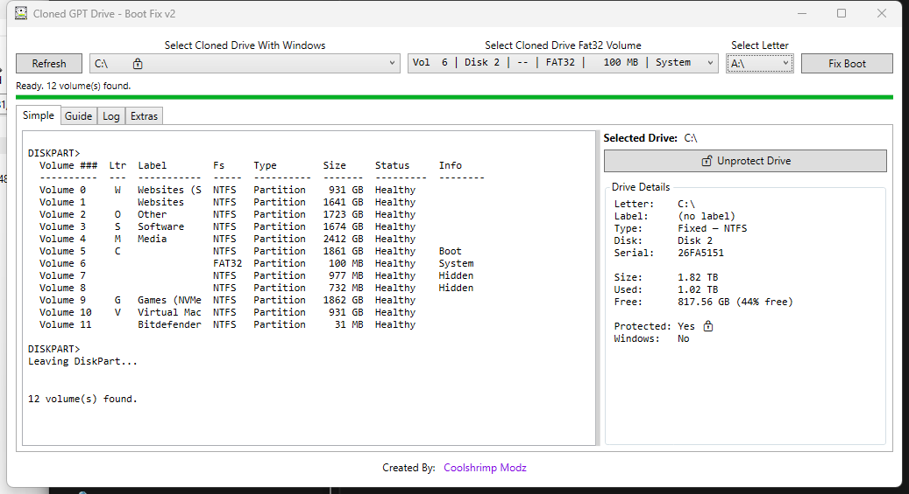
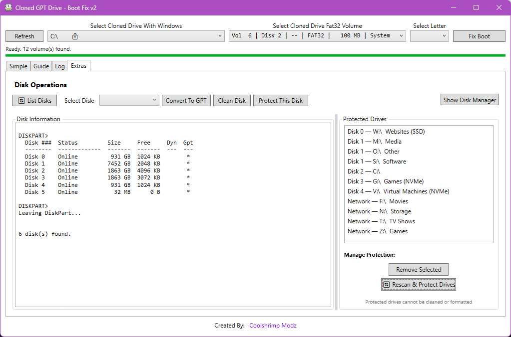

# Cloned GPT Drive - Boot Fix

A Windows utility for repairing the boot configuration on a GPT drive that was cloned from another machine. 
When you clone a GPT/UEFI Windows drive to a new physical disk, the boot files often don't match the new disk's EFI partition — this tool re-links them so the cloned drive boots correctly.

> ⚠️ **This tool performs low-level disk operations (diskpart, bcdboot) and requires Administrator privileges.** 

Read the [Safety Features](#safety-features) section before use.

## Screenshots

Main view — drive selection with Windows ★ / protected 🔒 markers, recommended EFI volume, and live drive details:



Extras tab — disk operations, and the protected drives list showing each protected disk:



## Features

- **Guided Boot Repair** — select your cloned Windows drive and its FAT32 EFI partition, assign a temporary letter, and repair the boot files in one click.
- **Guide Tab** — built-in step-by-step instructions inside the app.
- **Extras Tab** — list disks (with size, model and drive letters), convert a disk to GPT, clean a disk, or open Disk Management.
- **Protected Drives List** — mark disks (like your main OS disk) as protected so they can never be cleaned or wiped through this tool.
- **First-Run Protection** — on first launch, every connected local drive and the whole disk it is on is protected, and the app shows exactly what was protected.
- **Verified destructive actions** — Clean Disk, Convert to GPT and Fix Boot re-check the exact disk right before they run, and are blocked entirely for protected disks.

## How It Works

1. Connect the cloned drive to your PC.
2. Select the cloned drive (the one with Windows on it) from the dropdown.
3. Click **Refresh** and select the small FAT32 EFI partition on the cloned drive.
4. Pick any unused drive letter to use temporarily.
5. Click **Fix Boot**. The tool will:
   - Assign the temporary letter to the EFI partition
   - Run `bcdboot` to rebuild boot files from the cloned Windows installation
   - Remove the temporary letter again
6. Done — the cloned drive should now boot on its new hardware.

See the in-app **Guide** tab for the full walkthrough with screenshots-in-text.

## Safety Features

Because this tool can run destructive disk commands (`clean`, `convert gpt`, `bcdboot`), the following protections are built in:

- **Local disks only** — network drives are never listed, offered or touched.
- **Protected disks** (persisted per-user) — protection is tied to the physical disk itself (model, serial number and size), not just its drive letter, so a protected disk stays protected even if its letters change. Protected disks cannot be targeted by Clean Disk or Convert to GPT.
- **Automatic protection on first run** — every connected local drive and its whole disk is protected; use **Rescan & Protect Drives** to protect drives connected later.
- **The running Windows disk is always blocked** — the disk Windows is booted from, or that holds its system, boot or pagefile volumes, can never be cleaned or converted, protected list or not.
- **Exact-disk checks** — each disk is identified by its disk number, diskpart Disk ID, hardware identity and drive letters. All of them are checked when you click, and again right before diskpart runs; if anything changed (for example a USB drive was plugged in or removed and the numbers shifted), the operation stops without changing anything. Windows and diskpart must also agree on which drive letters belong to the disk.
- **Fails safe** — if a disk can't be identified, or diskpart's output can't be fully read, the operation is refused rather than assumed safe.
- **Fix Boot checks** — before assigning the temporary letter, Fix Boot re-checks that the EFI volume, its disk and the Windows drive are still exactly what you confirmed, and it only runs `bcdboot` after confirming the temporary letter landed on the right disk.
- **Confirmation dialogs** — destructive operations show the disk's model, size, serial number and every volume on it, and require an explicit Yes; Clean Disk requires a second "final warning" confirmation that names the disk again.

Even with these safeguards, **always double-check which disk/drive is selected before confirming any destructive operation.** This tool modifies partition tables and boot configuration — misuse can make a drive unbootable or erase data.

## Requirements

- Windows 10/11
- .NET Framework 4.7.2
- Administrator privileges (required for `diskpart` and `bcdboot`)


## Building from Source

Open `Cloned GPT Drive - Boot Fix.sln` in Visual Studio 2019+ and build the `Cloned GPT Drive - Boot Fix` project (Release or Debug), or build from the command line with MSBuild:

```
msbuild "Cloned GPT Drive - Boot Fix.sln" /p:Configuration=Release
```

Releases are built automatically by GitHub Actions: pushing a version tag (e.g. `v2.0.0`) compiles the app and publishes the zipped exe on the Releases page.

## Disclaimer

This software is provided "as is" with no warranty. Disk partitioning and boot repair operations carry inherent risk of data loss. Always back up important data before using disk utilities. See [LICENSE](LICENSE) for full terms.

## License

Licensed under the [MIT License](LICENSE).
